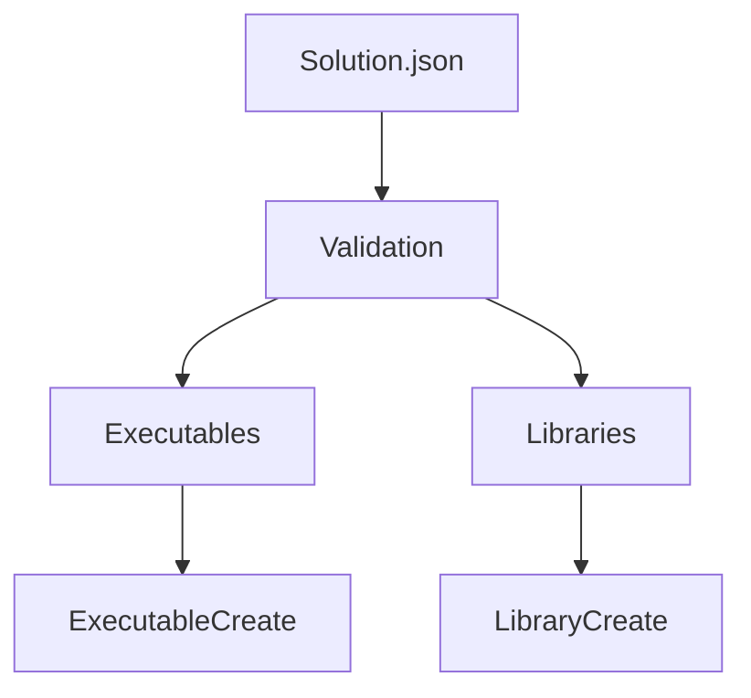

# Concept — Standard for Architecture Concepts

> **Version:** 1.0.1  
> **Date:** 2026-11-09  
> **Type:** Blueprint  
> **Status:** In Development  
> **Based on:** Doc v0.5, Blueprint v0.5  
> **Target Audience:** Documentation authors, architects  
> **Language:** English  
> **German:** [Concept.md](../../../de/autorenwerk/blueprints/Concept.md)

---

## Table of Contents

1. [Overview](#1-overview)
2. [Scope](#2-scope)
3. [Header Structure](#3-header-structure)
4. [Required Sections](#4-required-sections)
5. [Diagrams and Visualization](#5-diagrams-and-visualization)
6. [Documenting Decisions](#6-documenting-decisions)
7. [Example: Complete Concept](#7-example-complete-concept)
8. [Review Checklist](#8-review-checklist)
9. [See Also](#9-see-also)
10. [Changelog](#changelog)

---

## 1. Overview

This blueprint defines the **structure for architecture concepts**. Concept documents explain the **why** behind design decisions.

### Target Audience

- Build system developers
- Architects and technical leads
- New team members (onboarding)

### Delimitation

| Documentation type | Focus |
|-------------------|-------|
| **Concept** | Why was X decided this way? |
| **ModuleDoc** | How does module X work? |
| **Guide** | How do I use X? |
| **Reference** | What is X? |

---

## 2. Scope

This blueprint applies to:
- Architecture overviews
- Design decisions (ADRs)
- System concepts
- Pipeline descriptions

**Typical folder:** `docs/[lang]/konzepte/` (implemented concepts: `konzepte/abgeschlossen/`)

**Examples:**
- `abgeschlossen/Master_Concept.md`
- `abgeschlossen/AppContainer_Concept.md`
- `Konzept_Versionierter_Bezug.md`

---

## 3. Header Structure

### 3.1 Standard Header

```markdown
# [Name] — Concept

> **Version:** X.Y.Z  
> **Date:** YYYY-MM-DD  
> **Type:** Concept  
> **Status:** [In Development | Stable | Deprecated]  
> **Target Audience:** Build system developers, architects  
> **Language:** English  
> **German:** [Name_Concept.md](../../de/konzepte/Name_Concept.md)
```

### 3.2 Optional Fields

| Field | Description |
|------|--------------|
| `Relates to:` | Which modules/systems does this concept affect? |

---

## 4. Required Sections

Concepts use this structure:

```
## Table of Contents

## 1. Introduction / Vision
## 2. Problem Statement
## 3. Approach
## 4. Architecture
## 5. Design Decisions
## 6. Alternatives (rejected)
## 7. Open Points
## 8. See Also
## Changelog
```

### 4.1 Section Details

| # | Section | Content |
|---|-----------|--------|
| 1 | Introduction | Vision, goals, scope |
| 2 | Problem statement | Which problem is solved? |
| 3 | Approach | Chosen approach, core ideas |
| 4 | Architecture | Structure, components, data flow |
| 5 | Design decisions | Why this way and not another? |
| 6 | Alternatives | Approaches considered but rejected |
| 7 | Open points | Still to be clarified, future work |
| 8 | See also | Related concepts, modules |

---

## 5. Diagrams and Visualization

### 5.1 ASCII Diagrams

For simple structures:

```markdown
Pipeline flow
─────────────
Solution.json
     │
     ▼
┌─────────────┐
│ Validation  │
└─────────────┘
     │
     ▼
┌─────────────┐
│ Executables │
└─────────────┘
```

### 5.2 Mermaid Diagrams

For more complex structures (if supported by the renderer):
```
graph TD
    A[Solution.json] --> B[Validation]
    B --> C[Executables]
    B --> D[Libraries]
    C --> E[ExecutableCreate]
    D --> F[LibraryCreate]
```




### 5.3 Tables for Components

| Component | Responsibility | Input | Output |
|------------|---------------|-------|--------|
| Validator | Schema check | JSON | Error or OK |
| Collector | Collect data | JSON | Context |
| Creator | Create target | Context | CMake target |


---

## 6. Documenting Decisions

### 6.1 Format for Design Decisions

```markdown
### 5.1 Decision: GLOBAL PROPERTY instead of PARENT_SCOPE

**Context:**  
CMake variables have function scope. With nested calls 
(A calls B calls C), values set with PARENT_SCOPE are lost.

**Options:**

| Option | Pro | Con |
|--------|-----|--------|
| PARENT_SCOPE | CMake standard | Does not work with > 2 levels |
| CACHE INTERNAL | Persistent | Pollutes cache, slow |
| GLOBAL PROPERTY | Immediately global | No auto-cleanup |

**Decision:**  
GLOBAL PROPERTY with naming convention `${PREFIX}_${KEY}`.

**Rationale:**  
Reliable propagation is more important than auto-cleanup. 
The naming convention prevents collisions.

**Consequences:**
- All collector modules must use GLOBAL PROPERTY
- Debugging requires `ctx_dump()` instead of `message()`
```

### 6.2 ADR-Light Format

For important decisions, the ADR format can be used:

```markdown
### ADR-001: JSON as configuration format

**Status:** Accepted (2025-12-01)

**Context:**  
We need a machine-readable format for the solution configuration.

**Decision:**  
JSON with CMake 3.19+ `file(READ)` and `string(JSON)`.

**Consequences:**
- Positive: Native CMake support, widely used
- Negative: No comments in standard JSON
```

---

## 7. Example: Complete Concept

````markdown
# Context Pattern — Concept

> **Version:** 1.0.0  
> **Date:** 2025-12-13  
> **Type:** Concept  
> **Status:** Stable  
> **Target Audience:** Build system developers  
> **Relates to:** cmake/core/Context.cmake  
> **Language:** English  
> **German:** [Context_Pattern_Concept.md](../../de/konzepte/Context_Pattern_Concept.md)

---

## Table of Contents

1. [Introduction](#1-introduction)
2. [Problem Statement](#2-problem-statement)
3. [Approach](#3-approach)
4. [Architecture](#4-architecture)
5. [Design Decisions](#5-design-decisions)
6. [Rejected Alternatives](#6-rejected-alternatives)
7. [Open Points](#7-open-points)
8. [See Also](#8-see-also)
9. [Changelog](#changelog)

---

## 1. Introduction

The context pattern enables **isolated namespaces** for 
collecting data during pipeline processing. It solves the 
problem of the variable scope limitation in CMake.

### Goals

- Reliable data propagation across function levels
- Isolated namespaces per executable/library/test
- Simple debugging

---

## 2. Problem Statement

CMake variables have function scope:

```cmake
function(outer)
    set(MY_VAR "value" PARENT_SCOPE)  # Sets in caller
endfunction()

function(middle)
    outer()
    message("${MY_VAR}")  # EMPTY - not propagated
endfunction()
```

With nested pipeline calls, information is lost.

---

## 3. Approach

GLOBAL PROPERTY as storage with a naming convention:

```cmake
# Instead of PARENT_SCOPE
set_property(GLOBAL PROPERTY EXE_MyApp_NAME "MyApp")

# Read from anywhere
get_property(_name GLOBAL PROPERTY EXE_MyApp_NAME)
```

---

## 4. Architecture

````
ctx_create(EXE_MyApp)
        │
        ▼
┌───────────────────────────────┐
│  GLOBAL PROPERTY: EXE_MyApp_  │
│  ├── NAME = "MyApp"           │
│  ├── VERSION = "1.0.0"        │
│  └── EXTERNALS = "bass;imgui" │
└───────────────────────────────┘
        │
        ▼
ctx_get(EXE_MyApp NAME _var)
```

---

## 5. Design Decisions

### 5.1 GLOBAL PROPERTY instead of PARENT_SCOPE

[... as described in section 6.1 ...]

### 5.2 Naming Convention ${PREFIX}_${KEY}

**Context:** Multiple contexts could collide.

**Decision:** Prefixes: `EXE_`, `LIB_`, `TEST_`

**Rationale:** Unambiguous, self-documenting.

---

## 6. Rejected Alternatives

### 6.1 CACHE INTERNAL

**Problem:** Persists across configure runs, pollutes the cache.

### 6.2 Global Variables

**Problem:** No isolation between targets.

---

## 7. Open Points

- [ ] Automatic cleanup after a pipeline run
- [ ] Performance with >100 targets

---

## 8. See Also

- [Context.cmake](../../guide/module/core/Context.md)
- [ExecutableCollect.cmake](../../guide/module/project/ExecutableCollect.md)

---

## Changelog

| Version | Date | Changes |
|---------|-------|------------|
| **0.1.0** | **2025-12-13** | **Initial** |
```

---

## 8. Review Checklist

In addition to the Doc.md checklist:

**Content:**
- [ ] Problem statement clearly described
- [ ] Approach comprehensible
- [ ] Architecture visualized (diagram/table)
- [ ] Design decisions documented with rationale
- [ ] Rejected alternatives named

**Quality:**
- [ ] "Why" answered, not just "what"
- [ ] Understandable for new team members
- [ ] Open points honestly named

---

## 9. See Also

- [Doc.md](Doc.md) — General documentation rules
- [ModuleDoc.md](ModuleDoc.md) — For module details

---

## Changelog

| Version | Date | Changes |
|---------|-------|------------|
| **1.0.1** | **2026-11-09** | **Aligned with the code: location `docs/[lang]/konzepte/` with `abgeschlossen/` (§ 2), example file names without version, jump path `../../de/konzepte/`** |
| 1.0.0 | 2025-12-26 | Release 1 (carried over from newCMake, `2e00db7`) |
| 0.5.0 | 2025-12-13 | New: diagram formats, ADR-Light, decision documentation |
| 0.1.0 | 2025-12-03 | Initial (part of Documentation_Blueprint) |
